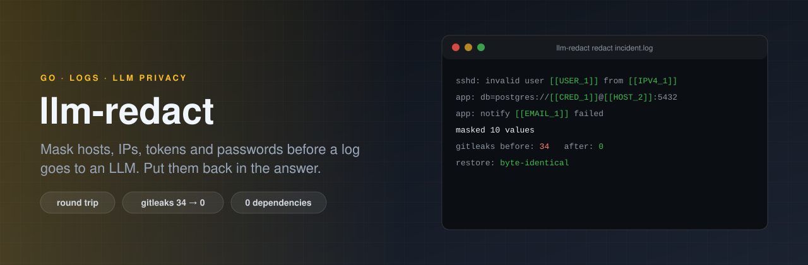

<p align="center">
  
</p>

# llm-redact

[](https://github.com/ErenOzgu/llm-redact/actions/workflows/ci.yml)


[](LICENSE)

Logs and configs are what you most want to ask an LLM about, and what you are least allowed to paste into one: they are full of internal host names, addresses, user names and credentials. `llm-redact` replaces those values with numbered placeholders, keeps the table on your machine, and puts the real values back into the answer.

The model still has enough to reason with: `[[HOST_1]]` cannot reach `[[HOST_2]]` is a fine sentence to debug. It just never learns what the hosts are called.

```text
$ llm-redact check incident.log          # what would be masked? never prints the values
incident.log:1:17: HOST (15 bytes)
incident.log:1:78: USER (5 bytes)
incident.log:1:89: IPV4 (11 bytes)
incident.log:2:57: CRED (16 bytes)
...

$ llm-redact redact -map incident.map.json incident.log
Oct 17 03:12:09 [[HOST_1]] sshd[2213]: Failed password for invalid user [[USER_1]] from [[IPV4_1]] port 4022 ssh2
Oct 17 03:12:11 [[HOST_1]] app[881]: db=postgres://[[CRED_1]]@[[HOST_2]]:5432/orders retry in 5s
Oct 17 03:12:11 [[HOST_1]] app[881]: notify [[EMAIL_1]] failed: 535 authentication failed
Oct 17 03:12:14 [[HOST_1]] app[881]: connect [[IPV4_2]]:5432: connection refused

# ...paste that into any chat, then put the model's answer through restore:
$ echo 'The app cannot reach [[HOST_2]] ([[IPV4_2]]); the login from [[IPV4_1]] is a scan.' \
    | llm-redact restore -map incident.map.json
The app cannot reach db01.prod.corp (10.20.30.40); the login from 203.0.113.9 is a scan.
```

The same value always gets the same placeholder, across files and across runs that share a map file, so a conversation over several turns stays consistent.

## Install

```sh
go install github.com/ErenOzgu/llm-redact/cmd/llm-redact@latest
```

or take a binary for Linux, macOS or Windows from the [releases](https://github.com/ErenOzgu/llm-redact/releases). It is one static binary with no third-party Go dependencies.

## Commands

| Command | What it does |
|---|---|
| `redact [file]` | Print the text with sensitive values replaced. `-map FILE` keeps the table (created with mode 0600, reused when it exists). |
| `restore -map FILE [file]` | Put the original values back. Placeholders that are not in the table are left alone and reported; `-strict` makes that an error. |
| `check file...` | List what would be masked, as `file:line:col: KIND (N bytes)` or `-json`. Exit status 1 if anything was found, and it never prints the values, so it is safe as a gate in a pre-commit hook or in front of an upload. |
| `ask -prompt TEXT [file]` | Redact, send to the Anthropic Messages API, restore the answer. `-dry-run` prints the request that would be sent and stops. |
| `list` | The kinds of value that are recognised. |

Options for `redact`, `check` and `ask`: `-skip HOST,USER`, `-only IPV4`, `-keep VALUE`, `-rule 'SERIAL=SN-([0-9]{8})'` or `-rules rules.json` for your own patterns (a capture group marks the part to mask), `-force`, `-max-bytes`.

`ask` reads `ANTHROPIC_API_KEY` (and optionally `ANTHROPIC_BASE_URL`, `LLM_REDACT_MODEL`). It tells the model what the placeholders are and to use them verbatim.

## What it recognises

| Kind | Examples |
|---|---|
| `PRIVKEY` | PEM private key blocks, including ones cut off in the middle, and keys inside JSON strings |
| `TOKEN` | AWS, GitHub, GitLab, Slack, Google, Anthropic, OpenAI-style, Stripe, npm, PyPI, Hugging Face, SendGrid, Docker Hub and DigitalOcean tokens; JWTs; the credential after `Bearer` or `Basic` |
| `SECRET` | the value after `password`, `secret`, `token`, `api_key`, `access_key`, `authorization`... in `key=value`, `key: value`, JSON, quoted or not. `${VAR}`, `$VAR`, `{{ template }}`, `true`, `null` are references or markers, not secrets, and are left alone |
| `CRED` | `user:password` inside a URL |
| `HASH`, `COOKIE`, `CARD` | crypt(3) hashes, values in `Cookie` and `Set-Cookie` lines, payment card numbers (Luhn checked) |
| `EMAIL`, `IPV4`, `IPV6`, `MAC` | loopback, `0.0.0.0`, broadcast and `ff:ff:ff:ff:ff:ff` are left alone; a `/24` after an address is kept |
| `USER` | `/home/NAME`, `C:\Users\NAME`, `user=NAME` and ssh log lines. Accounts every machine has (`root`, `www-data`...) are left alone |
| `HOST` | names under common or private top-level domains (`.com`, `.corp`, `.local`...). File names, `ssh.service`, well-known public sites (`github.com`, `pypi.org`...) are left alone |

## How it is checked

- **An independent scanner has to agree.** CI generates a corpus of fake credentials (an app log, `.env`, YAML, a shell script, a GCP service-account file with a real throw-away RSA key, an ed25519 key). [gitleaks](https://github.com/gitleaks/gitleaks) finds 34 secrets in it. After `llm-redact` it finds none, and `restore` gives back every file byte for byte. A control run that masks only IP addresses must still leave gitleaks with its 34, otherwise a clean result would mean nothing. (`hack/leakcheck.sh`)
- **Round trip and idempotence.** For thousands of generated texts, `restore(redact(x)) == x`, and redacting the output again changes nothing.
- **Fuzzing** the round trip on arbitrary input for a minute in every CI run.
- **No token survives** in ten different contexts each (bare, in JSON, in a URL query, after `Bearer`, in quotes...). The test tokens are assembled from pieces at run time, so no complete token is in the source.
- **`ask`** is tested against a local server that has the shape of the Messages API. It checks that none of the secrets is in the request body and that the answer comes back restored.

## What it cannot do

- **It finds what has a shape or a telltale key.** A password in the middle of a sentence, a customer name, a project code name, a serial number: not found. Add patterns with `-rule`, and look at the result (`redact`, or `ask -dry-run`) before you send anything that matters. It is a seat belt, not a guarantee.
- **It over-masks on purpose.** A four-part version number looks like an IPv4 address, `socket.io` looks like a host. Masked text is still readable; leaked text is not recoverable. `-skip` and `-keep` are there for the cases that matter to you.
- **It cannot restore what the model rewrites.** If the answer changes a placeholder, or invents `[[HOST_9]]`, the placeholder stays as it is and is reported.
- **The map file is as sensitive as the input.** It holds every masked value in clear text. It is created with mode 0600 and replaced atomically; delete it when the conversation is over.
- **`ask` has not been run against the real API from CI.** There is no key there. The request and response shapes are the documented ones, and the code path is tested against the fake server, but treat the first real call as a test.
- **Input that already contains placeholder-looking text** (`[[IPV4_7]]` that is not in the table) is refused, because restoring would be ambiguous. `-force` goes on anyway.
- Whole input is read into memory (limit 64 MiB, `-max-bytes`). It is not a streaming proxy.

## Design notes

- **`[[KIND_N]]`** because it is plain ASCII, rare in logs (`[INFO]` and `[[ ... ]]` in shell have no `_N`), survives markdown, and a model copies it reliably. Matching on the way back is case insensitive because models sometimes change case.
- **Numbering is per kind and per table**, so `[[IPV4_2]]` means the same thing in every file that shares the table.
- **Overlaps are resolved by priority**, not by position: a private key beats a token beats a URL credential beats a `key=value` secret beats a card, address, user name or host name. The password inside `postgres://app:pw@db.corp/x` is one `CRED`, and `db.corp` is a separate `HOST`.
- **`check` never prints values**, only kind, position and length.

## Layout

```
cmd/llm-redact/        main
internal/redact/       detectors, engine, mapping, restore (and their tests)
internal/cli/          the commands, including ask (and their tests)
hack/corpus/           generator for the fake-secret corpus
hack/leakcheck.sh      the gitleaks check CI runs
```

## License

MIT, see [LICENSE](LICENSE).
